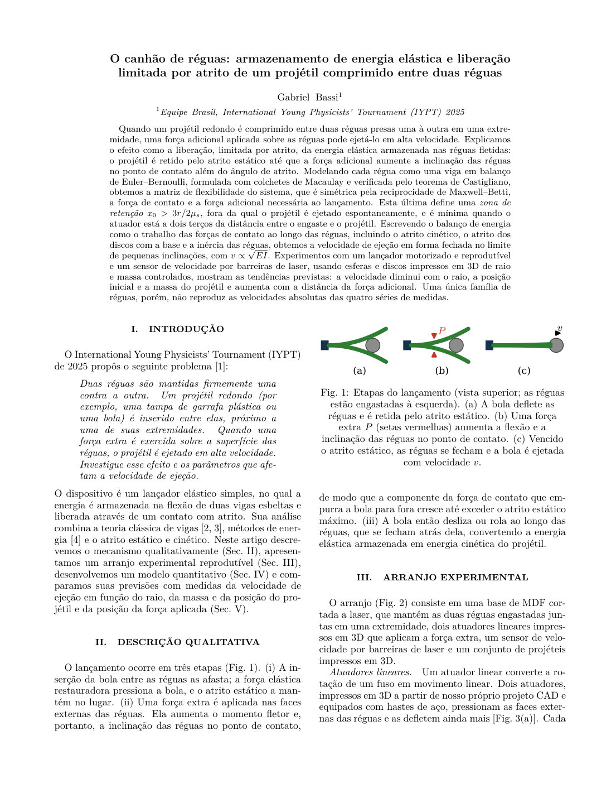
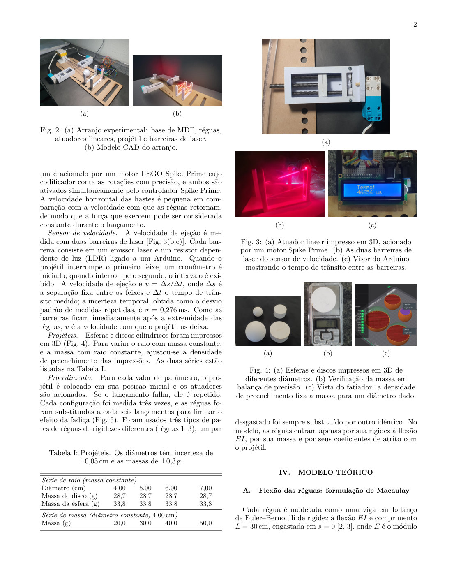
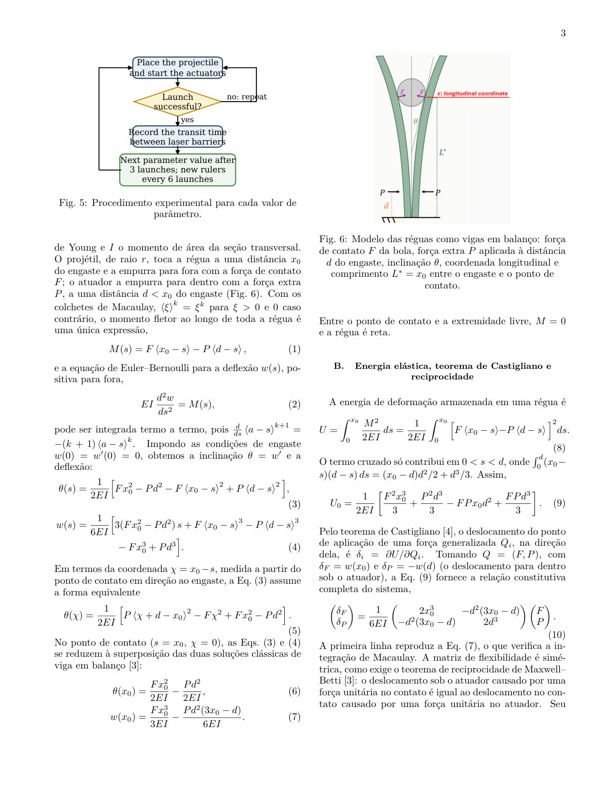
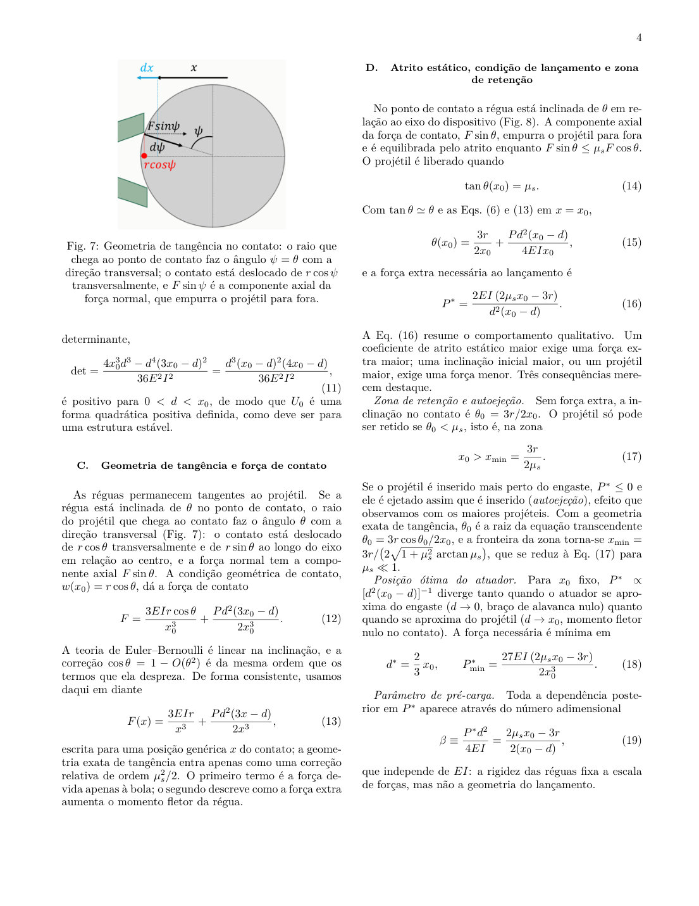
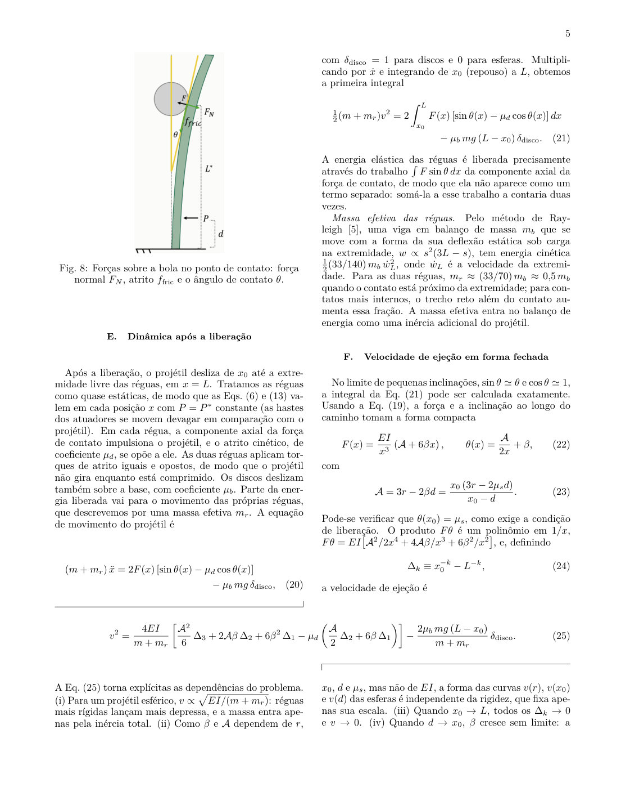
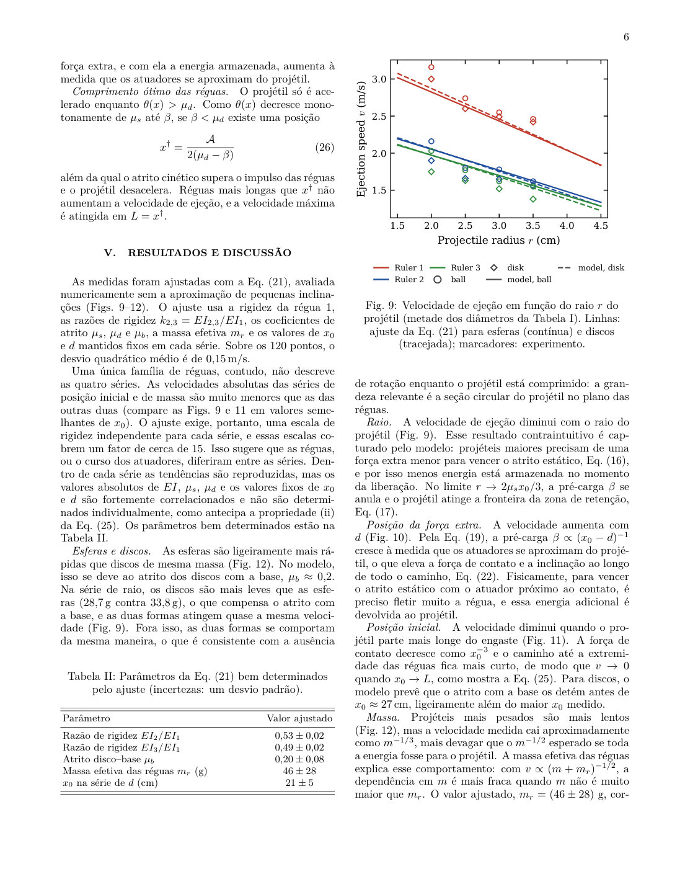
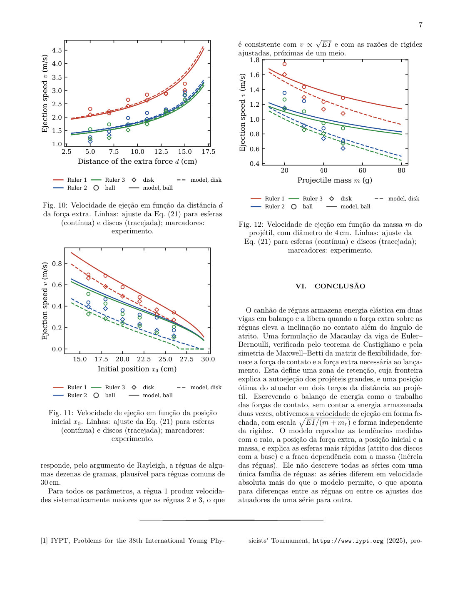
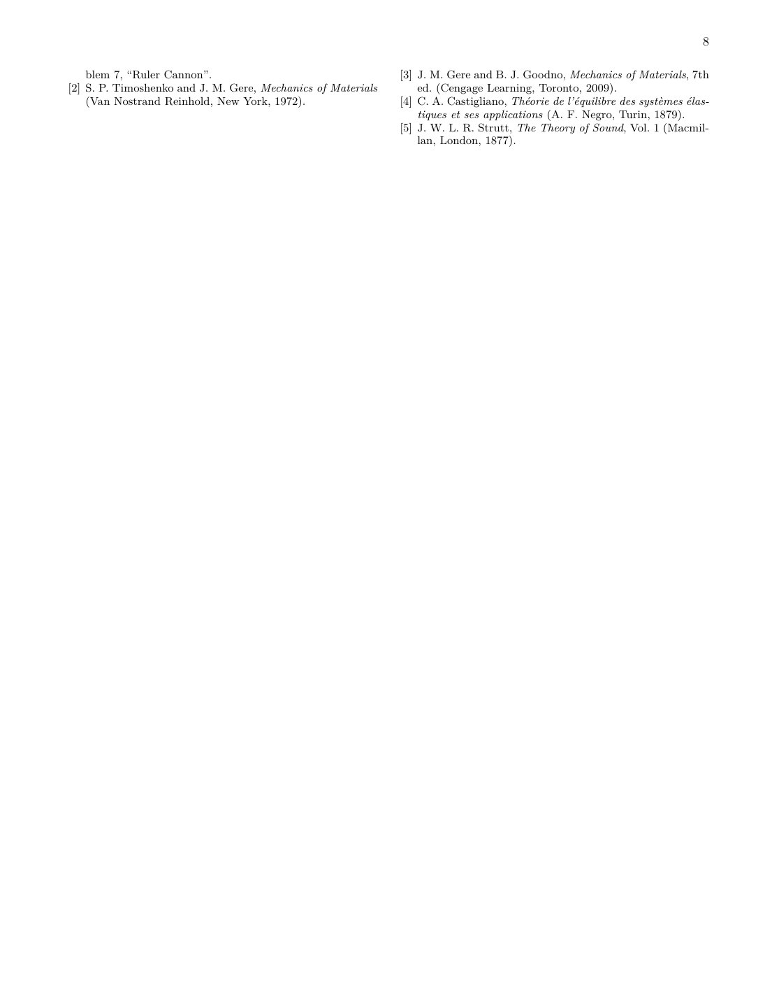

# O canhão de réguas

**Armazenamento de energia elástica e liberação limitada por atrito de um projétil comprimido entre duas réguas**

Gabriel Bassi — Equipe Brasil, International Young Physicists' Tournament (IYPT) 2025, Problema 7 ("Ruler Cannon").

**[Ler o artigo online](https://gabrielbassidebm.github.io/canhao-de-reguas-mecanica-elastica/)** · [Abrir o PDF](main.pdf) · [Baixar o PDF](https://github.com/GabrielBassiDeBM/canhao-de-reguas-mecanica-elastica/raw/main/main.pdf)

## Resumo

Um projétil redondo comprimido entre duas réguas presas em uma extremidade é ejetado em alta velocidade quando uma força extra é aplicada sobre elas. Cada régua é modelada como uma viga em balanço de Euler–Bernoulli, formulada com colchetes de Macaulay,

$$
EI\,\frac{d^2w}{ds^2} = F\langle x_0-s\rangle - P\langle d-s\rangle ,
$$

e verificada pelo teorema de Castigliano e pela reciprocidade de Maxwell–Betti da matriz de flexibilidade:

$$
\begin{pmatrix}\delta_F\\ \delta_P\end{pmatrix}
= \frac{1}{6EI}
\begin{pmatrix} 2x_0^3 & -d^2(3x_0-d)\\ -d^2(3x_0-d) & 2d^3\end{pmatrix}
\begin{pmatrix}F\\ P\end{pmatrix}.
$$

Os principais resultados teóricos são:

- a força extra necessária ao lançamento e a *zona de retenção*, fora da qual o projétil é autoejetado:

$$
P^\ast = \frac{2EI\,(2\mu_sx_0-3r)}{d^2(x_0-d)},
\qquad
x_0 > x_{\min} = \frac{3r}{2\mu_s};
$$

- a posição ótima do atuador, $d^\ast = \tfrac23 x_0$;
- a velocidade de ejeção em forma fechada, com $\Delta_k = x_0^{-k}-L^{-k}$:

$$
v^2 = \frac{4EI}{m+m_r}\left[\frac{\mathcal A^2}{6}\,\Delta_3 + 2\mathcal A\beta\,\Delta_2 + 6\beta^2\,\Delta_1
- \mu_d\left(\frac{\mathcal A}{2}\,\Delta_2 + 6\beta\,\Delta_1\right)\right].
$$

As previsões são comparadas com medidas feitas com um lançador motorizado e um sensor de velocidade por barreiras de laser, usando esferas e discos impressos em 3D.

## O artigo

O artigo completo, página a página. Para ler com zoom ou baixar, use os links no topo.










## Arquivos

- `main.tex`: fonte LaTeX (REVTeX 4.2, português)
- `references.bib`: referências
- `figures/`: figuras
- `main.pdf`: artigo compilado
- `paginas/`: páginas do artigo em imagem
- `index.html`: página de leitura (GitHub Pages)

## Compilação

Compile com pdfLaTeX + BibTeX (por exemplo, no Overleaf, enviando o repositório como projeto) ou localmente:

```
pdflatex main && bibtex main && pdflatex main && pdflatex main
```
